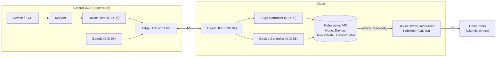

# Device Twins Resources Publisher (dtpublisher)

The Device Twins Resources Publisher is a cloud-side ContinuumX component built for the
UP2DATE4SDV project (component CID 93, task T3.4). It publishes the resource context of the
vehicle-to-cloud continuum, meaning Kubernetes nodes and device twins, to authorised consumers
over **Interface I-4**. ClOrch, the cloud orchestrator, is the primary candidate consumer.

It **only reads and publishes**. It never selects targets, schedules, rolls out or offloads
workloads: in UP2DATE4SDV those decisions belong to ClOrch and PlOrch, and ContinuumX executes and
reports.

Status: TRL 2 prototype. The interface (`i4/v1alpha1`) is a first draft. The transport, consumer
list, resource model and security mechanism are still open with project partners; each sits
behind a replaceable boundary (see [Open decisions and stand-ins](#open-decisions-and-stand-ins)).

- I-4 contract draft: [i4-contract.md](i4-contract.md)
- Code: [`cloud/pkg/dtpublisher`](../../cloud/pkg/dtpublisher), [`cloud/cmd/dtpublisher`](../../cloud/cmd/dtpublisher)

## Where it sits



Edge state reaches the Kubernetes API through the existing ContinuumX path. The Edge Controller
writes node status, and the Device Controller writes `DeviceStatus` twins. The publisher watches
four object types, all read-only:
- `Node`
- `Device`
- `DeviceModel`
- `DeviceStatus` (`devices.kubeedge.io/v1beta1`)

It keeps the current published state in memory and fans changes out to subscribers.

Name mapping to this repository:

| Component | Package |
|---|---|
| Device Twins Resources Publisher (CID 93) | `cloud/pkg/dtpublisher`, `cloud/cmd/dtpublisher` |
| Edge Controller (CID 90) | `cloud/pkg/edgecontroller` |
| Device Controller (CID 91) | `cloud/pkg/devicecontroller` |
| Cloud HUB (CID 92) | `cloud/pkg/cloudhub` |
| Edge HUB (CID 94) | `edge/pkg/edgehub` |
| EdgeD (CID 95) | `edge/pkg/edged` |
| Device Twin (CID 96) | `edge/pkg/devicetwin` |

### Why a separate binary

The publisher is its own binary and Deployment. It is not a module inside cloudcore or the
controller manager, for three reasons:
- **cloudcore and inherited code stay unchanged.** No staging API change is needed.
- **A slow consumer can't stall cloudcore.** Its message bus falls back to blocking sends when a
  module's channel is full, which would stall Cloud HUB dispatch.
- **The publisher fails on its own.** A publisher crash does not affect cloudcore. If cloudcore
  or an edge node is down, the publisher keeps serving the last known state, and nodes that stop
  reporting are published as `ready: Unknown`.

It runs as a **single instance**. Two replicas would publish two unrelated revision sequences, so
a consumer could not resume across them. High availability (for example leader election) is not
implemented.

## Code layout

| Package | Role |
|---|---|
| `model` | Published envelope, `schemaVersion`, node and device payloads, key scheme. |
| `store` | Current published state, with:<br/>- revisions and the per-process epoch<br/>- no-op suppression<br/>- non-blocking fan-out to subscribers<br/>- resume from a cursor, with a bounded delete history |
| `source`, `source/node`, `source/device` | Producers. The node source classifies nodes into categories. The device source joins `Device`, `DeviceModel` and `DeviceStatus`. A per-key throttle applies the minimum publish interval. |
| `transport` | Boundary to the I-4 protocol: `Publisher`, `Factory`, a registry, and the capabilities. |
| `transport/httpsse` | **PROVISIONAL** transport: HTTP/JSON with Server-Sent Events. |
| `transport/zenoh` | Reserved name. It always fails with "not implemented, to be discussed with ZSC and DLR". |
| `security` | TLS and mutual TLS server/client configuration; consumer identity from the verified client certificate. |
| `access` | Which consumer may read which key prefixes (`AllowAll`, or a static consumer list). |
| `client` | Go client of the httpsse transport (typed resources, watch with resume). |
| `testing/testpki` | Test certificates. |
| `cloud/cmd/dtpublisher` | The binary: `serve`, `ctl`, `version`. |

## Defaults and opt-ins

| Behaviour | Default | How to change |
|---|---|---|
| Subscription (standing data flow) | **On** | Always served. |
| Capabilities | On | Always served. |
| List and get queries | **Off** | `query.enabled: true` / `--enable-query` |
| Node source, device source | On | `sources.<nodes\|devices>.enabled: false` |
| Annotations | **None published** | `sources.<kind>.annotationKeys` / `--node-annotations`, `--device-annotations` (allowlist of keys) |
| Minimum interval per key | 0 (every change) | `minPublishInterval` / `--min-publish-interval` |
| Transport | `httpsse` on `:8443` | `transport.type`, `transport.httpsse.address` / `--transport`, `--listen-address` |
| TLS | **Required** | Plain HTTP only with `security.insecureDev: true` / `--insecure-dev` (development only) |
| Client certificates | `none` | `security.tls.clientAuth: optional\|require` / `--client-auth` |
| Consumer list | Empty: every consumer the TLS layer accepts may read everything | `access.consumers` (needs client certificates) |
| Heartbeat, subscriber buffer, write timeout | 15 s, 256 events, 30 s | `transport.httpsse.heartbeatInterval`, `bufferSize`, `writeTimeout` |
| Health and metrics | `:8080`, plain HTTP, not part of I-4 | `healthAddress` / `--health-address` |

## Configuration

`dtpublisher serve` reads an optional YAML file (`--config`). Unknown fields are an error, and
flags set explicitly override the file. Without `--kubeconfig` and `--master` it uses the
in-cluster configuration. A full example:

```yaml
# Kubernetes access; both empty: in-cluster.
kubeconfig: ""
master: ""
sources:
  nodes:
    enabled: true
    annotationKeys: []          # node annotation keys to publish
  devices:
    enabled: true
    annotationKeys: []
minPublishInterval: 0s          # per key; 0s publishes every change
transport:
  type: httpsse                 # or zenoh: not implemented
  httpsse:
    address: ":8443"
    heartbeatInterval: 15s
    bufferSize: 256
    writeTimeout: 30s
query:
  enabled: false                # list and get
security:
  insecureDev: false
  tls:
    certFile: /etc/dtpublisher/tls/tls.crt
    keyFile: /etc/dtpublisher/tls/tls.key
    clientAuth: none            # none | optional | require
    clientCAFile: ""            # required unless clientAuth is none
access:
  consumers: []                 # see below
healthAddress: ":8080"
```

A consumer list (requires `clientAuth: optional` or `require`):

```yaml
access:
  consumers:
    - name: clorch                # common name of the client certificate
      prefixes: ["nodes/", "devices/"]
    - name: vecu-demo
      prefixes: ["devices/default/"]
```

Each prefix is empty (everything) or ends with `/`. A consumer may subscribe to, list or get
only within its prefixes. A broader request is refused, not narrowed.

Flags of `serve`:
- `--config`
- `--kubeconfig`, `--master`
- `--transport`, `--listen-address`
- `--health-address`
- `--enable-query`, `--insecure-dev`
- `--tls-cert-file`, `--tls-private-key-file`, `--client-ca-file`, `--client-auth`
- `--min-publish-interval`
- `--node-annotations`, `--device-annotations`
- klog flags such as `--v`

## Build

```sh
# Binary, into _output/local/bin/
make all WHAT=dtpublisher BUILD_WITH_CONTAINER=false

# Image neotera/dtpublisher (hack/make-rules/image.sh uses docker)
make image WHAT=dtpublisher
```

With Podman instead of Docker, build `build/dtpublisher/Dockerfile` directly. Pass the version
ldflags as a build argument, so that `dtpublisher version` reports the build:

```sh
podman build --build-arg GO_LDFLAGS="$(hack/make-rules/version.sh)" \
  -f build/dtpublisher/Dockerfile -t docker.io/neotera/dtpublisher:dev .
```

The repository root has a `go.work`; Go commands use vendor mode with `GOWORK=off`, as the rest of
the build does. The image runs as non-root `65532:65532`, exposes `8443` (I-4) and `8080`
(health), and its default command is `serve`.

The `neotera/dtpublisher` image is **not yet published** to a registry. Push it to your own
registry, or load it into the containerd of the node that runs it
(`ctr -n k8s.io images import`).

## Deploy

All three ways deploy the same objects into the cloudcore namespace (`continuumx`):
- ServiceAccount
- ClusterRole: `get`/`list`/`watch` on nodes and on `devices`, `devicemodels` and `devicestatuses`
- ClusterRoleBinding
- ConfigMap with the configuration
- Deployment: one replica, non-root, read-only root filesystem, liveness and readiness probes
- Service for I-4 only, ClusterIP by default

The pod avoids edge nodes.

**Helm chart (cloudcore chart, key `dtPublisher`).** Disabled by default. When enabled it
publishes, keeps queries off, and requires TLS. Without `dtPublisher.security.tls.secretName`,
the chart generates a self-signed certificate (one year, not renewed) into Secret
`dtpublisher-tls`, with its CA in `ca.crt` for consumers. Invalid combinations fail at render
time:
- an unknown `clientAuth`
- client certificates without a CA Secret
- consumers without client certificates

**cxadm.** `cxadm` installs and renders the chart, and `--kubeedge-version` and
`--image-repository` apply to the publisher image too:

```sh
cxadm init ... --set dtPublisher.enable=true
cxadm manifest --set dtPublisher.enable=true --skip-crds     # render only
```

This needs a `cxadm` built from this branch; earlier releases do not contain the `dtPublisher`
values.

Main chart values:
- `enable`
- `image.{repository,tag,pullPolicy,pullSecrets}`
- `logLevel`
- `sources.*`
- `minPublishInterval`
- `query.enabled`
- `security.insecureDev`
- `security.tls.{secretName,clientAuth,clientCASecretName}`
- `access.consumers`
- `service.{type,port,nodePort}`
- `resources`, `affinity`, `tolerations`, `nodeSelector`

See the commented `dtPublisher` block in [`manifests/charts/cloudcore/values.yaml`](../../manifests/charts/cloudcore/values.yaml).

**Raw manifests.** [`build/dtpublisher/01-06*.yaml`](../../build/dtpublisher) are the chart output
for `dtPublisher.enable=true`, and a test keeps them in sync with the chart. Create the TLS
Secret first:

```sh
kubectl -n continuumx create secret tls dtpublisher-tls --cert=tls.crt --key=tls.key
kubectl apply -f build/dtpublisher/
```

The certificate must name the address consumers use, for example `dtpublisher.continuumx.svc`.

## Use

`dtpublisher ctl` is the operator client. Connection options:
- `--server` (or `$DTPUBLISHER_SERVER`; default `https://localhost:8443`)
- `--ca-file`
- `--cert-file`, `--key-file` for mutual TLS
- `--server-name`
- `-o`

```sh
export DTPUBLISHER_SERVER=https://dtpublisher.continuumx.svc:8443
dtpublisher ctl --ca-file ca.crt capabilities

# Subscribe: current state, then every change, one JSON line per event with the receive time.
# Reconnects with backoff and resumes from the last event ID; a refused request (4xx) is final.
dtpublisher ctl --ca-file ca.crt watch devices/default/
dtpublisher ctl --ca-file ca.crt watch nodes/edge-worker/ -o text
dtpublisher ctl --ca-file ca.crt watch --since 1842 --epoch 9f2c41d07a5be318

# Opt-in queries (publisher started with --enable-query)
dtpublisher ctl --ca-file ca.crt list nodes --category edge-worker
dtpublisher ctl --ca-file ca.crt list devices --node u2deb-edge
dtpublisher ctl --ca-file ca.crt get node u2deb-edge
dtpublisher ctl --ca-file ca.crt get device default/automotive-tire-pressure-ecu-fw-001 \
  --property frontLeftPressure --property lowPressureWarning
```

Go consumers can use the [`client`](../../cloud/pkg/dtpublisher/client) package: typed
resources, `Watch` with resume, and the opt-in queries. The wire format is in
[i4-contract.md](i4-contract.md).

## Operate

- **Health** (plain HTTP on the health port, not exposed by the Service):
  - `/healthz`: the process runs.
  - `/readyz`: every enabled source has published its initial state; `503` with the names of
    the sources still waiting.
- **Metrics** (Prometheus, `/metrics` on the health port):

  | Metric | What it counts |
  |---|---|
  | `dtpublisher_store_revision` | Current revision. |
  | `dtpublisher_resources{kind}` | Published resources per kind. |
  | `dtpublisher_subscribers` | Open subscriptions. |
  | `dtpublisher_changes_total{type}` | Accepted upserts and deletes. |
  | `dtpublisher_subscription_overflows_total` | Subscriptions ended because the consumer fell behind. |
  | `dtpublisher_source_synced{source}` | 1 when a source has published its initial state. |
- **Logs:** klog, verbosity `--v` (chart `logLevel`, default 2). Refused requests are logged at
  `--v=2`.
- **Restart:** a restart gets a new epoch. Subscribers reconnect and receive a fresh initial state.

## Security status

PROVISIONAL, until the mechanism is defined with WP4 (Cloud SASE Library, CID 30) against
REQ-ORP-0040:
- **TLS:** 1.2 minimum, required by default.
- **Client certificates:** optional mutual TLS against a configured CA. The consumer identity is
  the certificate's common name.
- **Authorization:** a static consumer list grants key prefixes.
- **Certificates** are read at start; rotating them needs a restart.
- **Plain HTTP** exists only behind `--insecure-dev`, for development playgrounds.
- **Health and metrics** are plain HTTP on a separate port and are not exposed by the Service.

## Open decisions and stand-ins

Four decisions are open with partners. None of them is settled in code: each sits behind an
interface and has a stand-in that can be replaced.

| Open decision | Boundary | Stand-in today |
|---|---|---|
| I-4 transport | `transport.Publisher` / `Factory`, chosen by `transport.type`. The core never imports a transport. | `httpsse`. `zenoh` is a registered name that is not implemented: "to be discussed with ZSC and DLR". No Zenoh library is included. |
| Consumers and what each needs | `access.Authorizer`, plus a key-prefix filter on every operation. | Static consumer list in the configuration. With no list, every consumer TLS accepts is allowed. No consumer is hard-coded. |
| Resource model and metric sources | `source.Source`, plus `schemaVersion` on every payload. | Nodes (capacity, allocatable, conditions, node info) and device twins as stored by ContinuumX. No usage, network-throughput or energy figures. |
| Security mechanism | `security.ServerConfig`, separate from `access.Authorizer`. | The TLS and mutual-TLS setup under [Security status](#security-status). |

## Test

Unit tests, including the race detector:

```sh
GOWORK=off go test -race ./cloud/pkg/dtpublisher/... ./cloud/cmd/dtpublisher/...
GOWORK=off go test ./keadm/cmd/keadm/app/cmd/helm/ -run 'TestDTPublisher|TestImageTags'
```

End-to-end checks on the ContinuumX playgrounds are in
[`tests/up2date4sdv/dtpublisher`](../../tests/up2date4sdv/dtpublisher). Both scripts do the same
steps:
1. Build the image with Podman and load it into the cloud node.
2. Deploy `build/dtpublisher/` with TLS from a generated test CA, with queries enabled.
3. Subscribe with `ctl watch`.
4. Drive the device twins through their desired values.
5. Check what the subscription receives, and compare `list` and `get` with the stream.
6. Write a trace under `_output/up2date4sdv/dtpublisher-e2e/`, restore the changed desired
   values, and remove the publisher.

```sh
# Docker (Podman Compose) playground
tests/up2date4sdv/dtpublisher/docker-e2e.sh --ecu thermal
tests/up2date4sdv/dtpublisher/docker-e2e.sh --ecu both --allow-ecu-state-change

# VirtualBox playground, from the VirtualBox host (key-based SSH, passwordless sudo on the VMs)
tests/up2date4sdv/dtpublisher/vbox-e2e.sh --ecu both --allow-ecu-state-change
```

The scenarios:
- **thermal:** a coolant setpoint. The desired value, the reported value and the changing
  telemetry must all be published.
- **tire:** a simulated front-left leak. The falling pressure and the low-pressure warning must be
  published. The ECU keeps the lost pressure, hence `--allow-ecu-state-change`.

The Docker check also stops and starts edgecore and expects the edge node to be published as
`ready: Unknown`, then `True`. On VirtualBox this check is opt-in (`--node-restart`), because the
playground's VM procedure says not to restart EdgeCore. `--help` lists all options.

Library tests that need no playground:

```sh
tests/up2date4sdv/dtpublisher/lib/e2e-common-test.sh
```

## Known limitations

- Single instance; no high availability.
- No pod-level resource data (allocatable minus requested) and no live usage metrics. The path
  for edge usage metrics through cloudcore's stream is not verified.
- Device values are strings, typed only by the model `type`. No standard signal names.
- Only properties declared in a `Device` reach the cloud, so only those can be published.
- Certificates are loaded once, at start.
- Each node status heartbeat produces an update of that node, unless a minimum publish interval
  is set.
